<p align="center">
  
</p>

[](https://github.com/StillAccursed/ADA/actions/workflows/ci.yml)

**ADA: Automated Deployment Assistant** is a cross-platform mod manager for **[Satisfactory](https://www.satisfactorygame.com/)**. It gives players more choice in how they manage their mods, with an emphasis on keeping the process straightforward and their factory operational.

ADA's core concept is efficiency. After all, failures cost time and money, and neither has been allocated to reinstalling your mods. Browse, install and update what you need, then return to the entirely reasonable task of rebuilding your power grid for the third time.

> **In development:** ADA is still being built. The dedicated Profiles, Servers and Activity pages are not yet available. Please report problems; the paperwork serves a purpose on this occasion.

## Features

- **Find your next productivity improvement.** Browse and search mods from [ficsit.app](https://ficsit.app), filter by tags, and save favourites.
- **Manage your mods.** Install, update, remove or select a specific version. Install individually or queue several together.
- **Let ADA work out the dependencies.** Required mods and compatible versions are resolved for your selected game installation.
- **Recover from interruptions.** ADA can recover interrupted mod changes and check for damaged or missing mod files, with repair where possible.
- **Keep useful downloads.** Optionally retain downloaded mod archives for reuse, and clear the cache from Settings when storage becomes the next bottleneck.

## Supported Platforms

| Platform | Supported game installations |
| --- | --- |
| Windows | Steam and Epic Games Launcher |
| Linux | Steam, including Flatpak and Snap installations, with Proton; Epic through Heroic or Legendary |
| macOS | Steam or Epic inside a CrossOver bottle |

ADA detects launcher-managed installations automatically. Custom game-folder selection is not currently available. On macOS, Satisfactory runs through CrossOver; ADA itself is a desktop app for macOS.

## Installation and Usage

For a development build, install the [.NET 10 SDK](https://dotnet.microsoft.com/download) and Git, then run:

```bash
git clone https://github.com/StillAccursed/ADA.git
cd ADA
dotnet run --project ADA
```

Once ADA is open:

1. Let it find your Satisfactory installations and load the mod catalogue.
2. Open **Mods** and select the game installation you want to manage.
3. Find a mod and choose **Install**, or queue several and install them together.
4. Wait for ADA to finish, then launch Satisfactory through your usual launcher.

Close Satisfactory before changing its mods. Even an efficient factory benefits from stopping the machinery before replacing parts.

## Reporting Issues

Report bugs and request features in the [issue tracker](https://github.com/StillAccursed/ADA/issues). For bugs, please include:

- Your operating system, ADA version or source commit, and game launcher. On macOS, include your CrossOver version.
- What you were doing, what you expected, and what actually happened.
- Steps to reproduce the problem, the affected mod names and versions, and any error message or useful screenshot.
- The latest ADA log, after checking it for personal information you do not want to share.

Logs are stored here:

| Platform | Log folder |
| --- | --- |
| Windows | `%LOCALAPPDATA%\ADA\Logs` |
| Linux | `~/.ada/Logs` |
| macOS | `~/Library/Application Support/ADA/Logs` |

“It broke” is a valid emotional response. The details above make it an actionable report.

## Development

ADA is built with **C#**, **.NET 10** and **Avalonia**. With the .NET 10 SDK installed, run these commands from the repository root:

```bash
dotnet build ADA.sln
dotnet test ADA.sln
dotnet run --project ADA
```

Contributions are welcome. For substantial changes, open an issue to discuss the approach first. Unscheduled construction is already sufficiently represented in the game.

## Credits

Thank you to the Satisfactory modding community, the mod authors, and the maintainers of [ficsit.app](https://ficsit.app), which supplies the mod catalogue and downloads.

ADA also relies on these open-source projects:

| Project | Used for | Licence |
| --- | --- | --- |
| [Avalonia](https://avaloniaui.net/) | Cross-platform UI | MIT |
| [Inter](https://rsms.me/inter/) (via Avalonia.Fonts.Inter) | UI typeface | SIL Open Font License 1.1 |
| [CommunityToolkit.Mvvm](https://github.com/CommunityToolkit/dotnet) | View models and commands | MIT |
| [Markdown.Avalonia](https://github.com/whistyun/Markdown.Avalonia) | Formatted mod descriptions | MIT |
| [AvaloniaEdit](https://github.com/AvaloniaUI/AvaloniaEdit) | Renderer dependency | MIT |
| [HtmlAgilityPack](https://github.com/zzzprojects/html-agility-pack) | Renderer HTML parsing | MIT |
| [Microsoft.Extensions.DependencyInjection, Http, Logging](https://github.com/dotnet/runtime) | Service wiring and HTTP clients | MIT |
| [Microsoft.Data.Sqlite](https://github.com/dotnet/efcore) | Local mod catalogue | MIT |
| [SQLite](https://sqlite.org/) (via SQLitePCLRaw) | Database engine and search | Public domain (SQLitePCLRaw: Apache-2.0) |
| [Dapper](https://github.com/DapperLib/Dapper) and [Dapper.AOT](https://github.com/DapperLib/DapperAOT) | SQL mapping | Apache-2.0 |
| [Polly](https://github.com/App-vNext/Polly) | Retries and backoff | BSD-3-Clause |
| [CliWrap](https://github.com/Tyrrrz/CliWrap) | Running system commands | MIT |
| [Serilog](https://serilog.net/) | Log files | Apache-2.0 |
| [Semver](https://github.com/WalkerCodeRanger/semver) | Version parsing | MIT |
| [xUnit](https://xunit.net/) | Tests | Apache-2.0 |

ADA's own source is available under the [MIT licence](LICENSE). Third-party projects retain their own licences; see [Third-party notices](THIRD-PARTY-NOTICES.md) for the mod description renderer and its dependencies. Mod data and downloads remain subject to ficsit.app's terms.

ADA is independently written using public API documentation and observed file formats. It does not copy or port code from Satisfactory Mod Manager.

Satisfactory is a trademark of Coffee Stain Studios. ADA is a community project and is not affiliated with or endorsed by Coffee Stain Studios.
